# My own Pacman for Reinforcement Learning
This depository contains the code of a Pacman game I wrote from scratch for testing reinforcement learning algorithms.

Currently, 2 algorithms are implemented, DQN and A2C (trained with PPO updates by default).

A comprehensive course on reinforcement learning, from bandits and Markov decision processes to
deep RL, planning, offline RL, multi-agent RL and RLHF, with this game as running example, is in
the folder `Course` ([PDF](Course/rl_with_pacman.pdf)).

## To run games

To let Pacman play games run the command below in a terminal.
```bash
python pacman_play.py
```

By default, the trained A2C agent saved in `./Trainings/A2C/PPO_1/pacman_a2c_final.pth` plays one game.
The options are listed with `python pacman_play.py --help`. For example:
```bash
python pacman_play.py -n 1000                         # statistics over 1000 games
python pacman_play.py -c Tmp/pacman_a2c_final.pth     # another checkpoint (e.g. a new training)
python pacman_play.py -a dqn                          # the DQN agent (./Trainings/DQN/pacman_dqn_final.pth)
python pacman_play.py --speed 0.3 --wait 10           # slower display
python pacman_play.py -n 200 --show-losses            # replay up to 5 of the lost games with display
```

The game configuration (board, ghosts, rewards) is the one defined in `pacman_training.py`,
so that the agent plays the game it was trained on.

With one game (`-n 1`, the default), the game is displayed as in the example below.

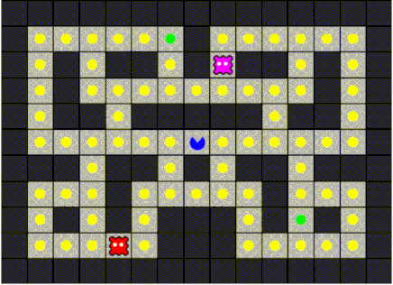

(***In the "Media" directory you will find the same with music...***)

With more games, they are played without display and statistics are provided at the end.

This is the output obtained with `-n 1000` with the current A2C agent (trained with PPO, see below).
```bash
Pacman won 96.60% of the games
Number of game aborted:
	with 0 ghost: 0
	with 1 ghost: 0
	with 2 ghost: 0
Percentage of games with
	0 ghost: 93.6
	1 ghost: 3.3
	2 ghost: 3.1
Average number of ghost per game: 0.095
Percentage of power cookies eaten per game:
	0 power cookies: 2.9
	1 power cookies: 0.3
	2 power cookies: 96.8
Average number of power cookies eaten per game: 1.939
```

For comparison, the original A2C agent (stride-2 network, RGB input with 1 frame, n-step returns,
no PPO) obtained:

| | Original A2C | Current A2C (PPO) |
|---|---|---|
| Games won | 79.4% | 96.6% |
| Games ending with 0 ghost left | 51.4% | 93.6% |
| Games with both power cookies eaten | 83.4% | 96.8% |
| Average number of ghosts left | 0.69 | 0.095 |

Each game is played with its own random seed (printed at the end), so a set of games can be played
again identically with `--seed`. With `--show-losses N`, the games are first played without display,
then up to `N` of the lost games are replayed with display, to see how Pacman loses.

With several games, the lost games are also classified by cause:
- `off-by-one`: Pacman moved onto a ghost on the move where his power ran out. The power credit is
  decreased at the beginning of Pacman's move, before the collision test, so with 1 move of power
  left, moving onto a ghost kills Pacman.
- `power-ended`: Pacman was caught at most 3 moves after his power ran out (other cases).
- `bad-start`: Pacman was caught in the first 5 moves of the game, without having had any power.
- `other`: all the other lost games.

`--cause` selects the games to replay, e.g. `python pacman_play.py -n 1000 --show-losses --cause off-by-one`.

### Look-ahead search

With `--search N`, a look-ahead search (`pacman_search.py`) checks the agent's moves when a ghost is
close (at most `--radius` cells, 5 by default). Each possible move is simulated `N` times on copies of
the game: the move is played, then the trained agent plays alone for at most `--horizon` moves (15 by
default). In the default `safety` mode, the agent's move is kept unless Pacman dies in clearly more
simulations with it (15% more) than with another move; the search then plays the move with the
fewest deaths. It corrects the agent when it walks into a trap, which the network alone does not
always see.

> **The search does not know how the ghosts really behave.** By default (`--ghost-model chase`), the
> simulated ghosts do not use the game's code for the ghosts: they always move towards Pacman when he
> has no power (worst case), and randomly when he has power. The search only uses what the agent can
> observe (the positions of the ghosts, of Pacman and of the cookies, Pacman's power) and the rules of
> the game for Pacman (moves, cookies, power, collisions). The ghosts' real behaviour (`exact`) is used
> only if it is explicitly chosen, and it was only used as a reference for comparison (see below).

```bash
python pacman_play.py -n 1000 --search 20 --workers 8    # 8 games played in parallel
```

The search is slow (about 100 simulated games per searched move), so `--workers` plays several games
in parallel.

`--ghost-model` sets how the ghosts move in the simulations:
- `chase` (default): worst case, the ghosts always move towards Pacman (along a shortest path) when he
  has no power, and randomly when he has power.
- `estimated`: when Pacman has no power, a ghost moves towards him with probability `p_chase`, and
  randomly otherwise; when he has power, it moves away from him with probability `p_flee`, and
  randomly otherwise. Both probabilities are estimated for each ghost from its observed moves since
  the beginning of the game.
- `exact`: the game's own code for the ghosts, i.e. a perfect knowledge of their behaviour.

`chase` and `estimated` do not use the game's code for the ghosts: the search only uses what an agent
can observe, while `exact` would give it knowledge that the agent does not have. (Over many games, the
estimates are about 0.73 and 0.64 for `p_chase`, close to the configured aggressiveness levels 0.74 and
0.64, and about 0.08 for `p_flee`: edible ghosts move almost randomly.)

With 20 simulations per move, the search was evaluated on 1000 games (all the lost games, and a sample
of about 200 of the won games, replayed with search):

| Ghost model | Estimated win rate |
|---|---|
| no search | 96.1% |
| `exact` | 97.1% (± 0.5) |
| `chase` | 97.5% (± 0.5) |
| `estimated` | 97.7% (± 0.3) |

The gain (about 1 to 1.5 points) does not come from knowing the ghosts' code. Most of the lost games
that are not saved are bad starts. The `value` mode (`--search-mode value`, play the move with the
best simulated score) did not improve the win rate: with 20 simulations, the averages are too noisy
and it changes many good moves by chance.

## To train the model

To train the model run the command below in a terminal.
```bash
python pacman_training.py
```

In the main function in file `pacman_training.py` you can select the agent you want to train.

```Python
if __name__ == "__main__":
    
    #dqn_training()
    a2c_training()
```

You can also configure the game, the hyperparameters (e.g `initial_learning_rate`), etc.

Example:
```Python
pacman_conf = PacmanConf(playground = pacman_map3,
                         ghost_aggressiveness_levels = [0.74, 0.64],
                         edible_ghosts_behavior = [EdibleGhostBehaviors.FLEE_FAST,EdibleGhostBehaviors.FLEE_FAST],
                         n_ghosts = 2,
                         n_power_cookies = 2,
                         max_power_credit = 12,
                         eat_cookie_reward = 0.8,
                         eat_power_cookie_reward = 1.3,
                         eat_ghost_reward = 20,
                         living_cost = -0.15,
                         lose_reward = -35,
                         win_reward = 30,
                         penalty_per_ghost = -5)
```

### GPU

Both agents automatically run on a CUDA GPU (or Apple Silicon `mps`) when one is available,
and fall back to the CPU otherwise. A device can be forced with the `device` argument
(e.g. `DQN_PacmanAgent(envs, device="cpu")`).

### A2C / PPO

The actor-critic agent has the following features:
- **Input**: instead of an RGB image, the state is made of feature planes
  (`PacmanEnvironment.feature_image`): walls, cookies, power cookies, Pacman, one plane per ghost
  (the ghosts have different aggressiveness, so the agent can tell them apart) and Pacman's remaining power.
  Walls can no longer be confused with empty cells.
- **2 stacked frames** (one stack per environment), so that the direction in which the ghosts move is visible.
- **Network**: full-resolution convolutions shared by a policy head and a value head. Since the board
  is left-right symmetric, the network is made exactly equivariant to this symmetry: the outputs for a
  state and for its mirror image (with East and West swapped) are averaged. The agent cannot learn a
  different behaviour on the two halves of the board, which is equivalent to doubling the training data.
- **Advantages**: GAE($\lambda = 0.95$), normalised per mini-batch.
- **Updates**: PPO clipped objective, 4 epochs of 4 mini-batches on each rollout of
  16 environments × 128 steps. With `ppo_epochs=1` and `n_minibatches=1` the update is exactly A2C (with GAE).
- **Curriculum**: the ghosts' aggressiveness starts at 30% of its configured value and reaches 100%
  after 20% of the training.

Statistics for every game are saved in `./Tmp/pacman_a2c_training_log.csv`.

Training curves of the agent saved in `./Trainings/A2C/PPO_1` (40 million steps on a Kaggle GPU;
averages over the last 2000 games):


### DQN

The DQN agent combines the improvements that matter most in practice:
- **Double DQN** targets (the online network picks the next action, the target network evaluates it),
- a **dueling** network $Q(s,a) = V(s) + A(s,a) - \overline{A}(s,\cdot)$ whose convolutions keep the full board resolution,
- **3-step returns**, which propagate the sparse rewards (eating a ghost, winning) much faster,
- a slowly moving (Polyak, $\tau = 0.005$) **target network**,
- **reward scaling** (×0.1) so that the TD errors stay in the range where the Huber loss works well,
- 2 stacked frames, so that the network can see in which direction the ghosts move.

Training is driven by environment steps: all the environments move in lockstep, the actions for
all of them come from a single batched forward pass, finished games restart immediately, and
the network is updated after every move (`train_freq=1`, i.e. each transition is replayed about
8 times with 16 environments and batches of 128). On a CPU, `train_freq=2` halves the cost.
Statistics (rewards, win/loss rates, ghosts left, ...) for every game are saved in
`./Tmp/pacman_dqn_training_log.csv`.

To train it, uncomment `dqn_training()` in `pacman_training.py`.

Without a local GPU, the notebooks `./Tools/train_kaggle.ipynb` and `./Tools/train_colab.ipynb`
train the A2C/PPO or the DQN agent on a free Kaggle or Google Colab GPU, save checkpoints
regularly, and can resume a previous training. A training longer than one session (Kaggle
stops sessions after 12 hours) is split automatically: the session stops after `MAX_HOURS`, and
the next one (`RESUME_FROM = "auto"`) continues it with the same schedules (exploration and
learning rate for DQN; learning rate and curriculum for A2C, with Adam's state). A session that
was lost continues the same way from its last checkpoint.

**Results (game v1).** The agent `Trainings/DQN/pacman_dqn_final.pth` was trained on a Kaggle GPU.
Three runs show how much the learning rate matters. All of them decrease epsilon from 1 to 0.02
over the first 15M steps.

Run 1 (60M steps, learning rate decreasing from 2.5e-4 to 5e-5): the reward collapsed when
exploration ended, and the agent won no game for 55M steps; it only took off at the very end,
once the learning rate had become small.

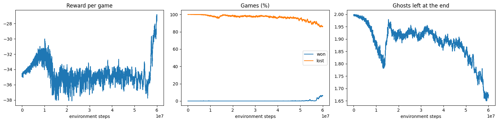

Run 2 resumed run 1 for 50M steps at a learning rate of 5e-5 and reached about 50% of games won.

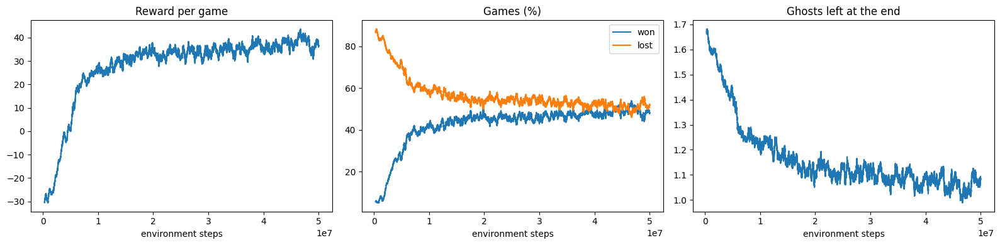

Run 3 started again from scratch with the same settings as run 1 except the learning rate
(decreasing from 1e-4 to 2.5e-5). At the moment where run 1 collapsed, run 3 took off: from 1% to
40% of games won between 12M and 15M steps, then about 65% after 60M steps. This is the current
checkpoint.

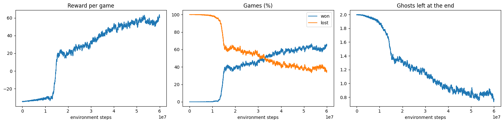

On 1000 games (`python pacman_play.py -a dqn -n 1000`) it wins **67.2%** of the games. Once both
ghosts are eaten, `pacman_play.py` lets the DQN agent play a random move with probability 0.05
(`--greedy` to disable): played fully greedily, it sometimes goes round in circles in an area
already cleared and wins 66.1%. The A2C/PPO agent wins 96.6% of the games after about 20M steps.

Run 4 fine-tuned run 3 for 35M more steps (learning rate 2.5e-5, epsilon fixed at 0.02) and did
not improve it. A checkpoint holds only the network: the replay memory starts empty and Adam's
statistics start from zero. The games won fell from about 60% to under 50% as soon as the updates
started, and came back only to about 58%. On the same 1000 games, the fine-tuned agent wins 63.1%,
so run 3 remains the current checkpoint.

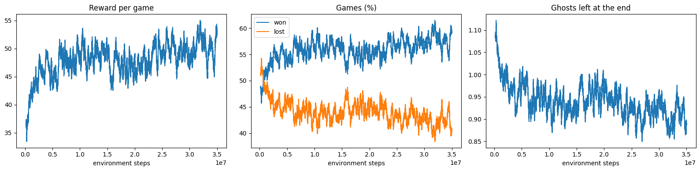

With the ipython notebook `./Tools/plottings.ipynb` it is possible to visualize 
the progress of the training. Below is an example of the plotting of the training
evolution.
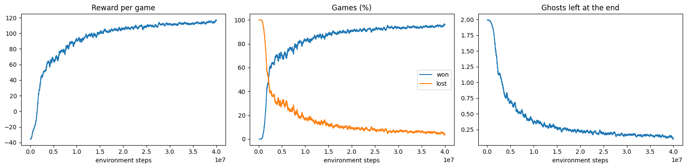

### Expert iteration: the search as teacher

`pacman_expert.py` trains the A2C agent with the look-ahead search as teacher (expert iteration,
in its DAgger form). Each iteration:
1. The current agent plays games alone (in parallel processes). At each move where a ghost is
   close, the search (safety mode) gives the move it would play: as the games are played by the
   agent, the search labels exactly the situations the agent gets into, including its mistakes.
2. The policy learns to play the search's move where a ghost is close (with a larger weight where
   the search disagrees with the agent), and its own move elsewhere, so that the rest of its play
   does not change. The value head learns the discounted returns observed in the games.

The games of each iteration are played without search, so their results measure the agent alone.
**As for `pacman_play.py --search`, the search uses the `chase` ghost model by default: the labels that
the network learns do not come from any knowledge of the ghosts' real behaviour.**
It starts from the agent in `Trainings/A2C/PPO_1`:
```bash
python pacman_expert.py --iterations 10 --games 2000 --workers 4    # see --help for the options
python pacman_play.py -c Tmp/expert/pacman_expert_final.pth -n 1000
```
In the notebooks, set `AGENT = "expert"`.

Result of a training on Kaggle (10 iterations of 2000 games, search with 10 simulations and a horizon of
10, `chase` ghosts), starting from the agent in `Trainings/A2C/PPO_1`. The agent obtained is saved in
`Trainings/A2C/Expert_1`. On the same 1000 evaluation games, without search:

| Agent, no search | Games won |
|---|---|
| `PPO_1` (start) | 95.8% |
| `Expert_1` (after 10 iterations) | 96.7% |

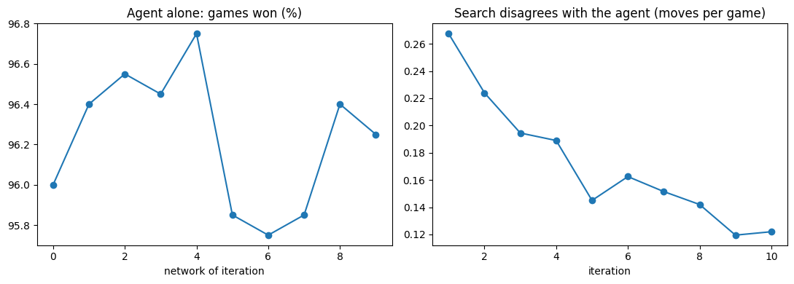

Each point of the left plot is measured on a different set of 2000 games (± 0.4 points), so its ups and
downs are mostly noise. The right plot shows the clearer effect: the search disagrees with the agent half
as often after training (0.27 then 0.12 times per game), and the network reproduces 76% of the search's
corrections. The gain (about +0.7 to +0.9 points, ± 0.6 on 1000 games) is about half of what the search
gives when it is used during the games (97.5% to 97.7%, see above).

One iteration took about one hour: almost all of it is the collection of the games with search, which
runs on the CPU (4 processes), so the GPU is hardly used.

Both agents, with and without search, on the same 1000 games
(`python pacman_play.py -c <agent> -n 1000 --seed 1 -w 8 [--search 20]`):

| Same 1000 games | Without search | With search (20 simulations) |
|---|---|---|
| `PPO_1` | 97.1% (29 lost) | 98.1% (19 lost) |
| `Expert_1` | 97.7% (23 lost) | 97.9% (21 lost) |

Expert iteration and the search correct the same mistakes: without search, the expert agent is better
(it recovers about 60% of the search's gain, and no longer loses games by the off-by-one), but with the
search both agents reach about 98% (the difference of 2 games is within the noise). The same 3 bad starts
are lost in all four cases. The 15 to 18 other lost games resist both methods: they are probably traps
from which the agent's own policy, which plays the simulations, cannot escape either. So `Expert_1` is
the best choice without search (no extra cost), and either agent with `--search 20` gives the best results.

(On these 1000 games `PPO_1` alone wins 97.1%, more than its usual 96%: the absolute levels vary from
one set of games to another, but the differences inside the table are reliable, since all four
configurations play the same games.)

## Game v2

On the original game (now called `v1`), the trained agents win more than 96% of the games, and they
usually eat both ghosts early: the rest of the game is then only about collecting cookies. Game `v2`
makes the whole game matter:

| | `v1` | `v2` |
|---|---|---|
| Maze | `pacman_map3` (11 x 15, 77 open cells) | `pacman_map4` (17 x 19, 163 open cells, ghost house) |
| Ghosts | 2 (aggressiveness 0.74, 0.64) | 3 (0.74, 0.64, 0.52) |
| Ghosts start | at random cells | in the ghost house (see below) |
| Eaten ghosts | never come back | go back to the ghost house (see below) |
| Power cookies | 2 | 4 |
| Power duration | 12 moves | 10 moves |
| Reward for eating a ghost | 20 | 5 |
| Penalty per ghost left at the end | -5 | 0 |
| Reward for a cookie eaten with power | 0 while a ghost is left | 0.8 (\*\*) |
| Reward for a power cookie | 1.3, up to 10 times more when a ghost is close | 1.3 (\*\*) |
| Random moves of the ghosts prefer their current direction | no (\*) | yes (weight 1.5) |

(\*) The code intends a weight 1.5 for the move that keeps a ghost's direction, but in `v1` it
compares a position with a direction letter, which is never true: the random moves are uniform.
The fix is enabled by `PacmanConf.ghost_keep_direction`, so that the games of `v1` are unchanged.

(\*\*) Since the eaten ghosts come back, there is always a ghost left: with the rewards of `v1`, the
cookies eaten with power were worth nothing and the power cookies were worth more with a ghost close,
which made Pacman hunt the ghosts with his power instead of clearing the maze. These two rewards were
changed (`PacmanConf.cookie_reward_with_power`, `PacmanConf.power_cookie_ghost_bonus`) after runs 1 to
3 of the A2C agent (see [Results on v2](#results-on-v2)), which were trained with the rewards of `v1`.

The other rewards are the same. `pacman_map4` is left-right symmetric (as required by the symmetric
network), has no dead ends and no open areas.

The ghosts start in the ghost house, 3 cells in the middle of the maze (value `2` in the map, blocked
for Pacman), and an eaten ghost goes straight back to it. When Pacman has no power, each ghost in the
house leaves it with probability `ghost_house_exit_prob` (0.1) at each move, through the door above the
house, if the door is free. So a ghost that comes out is always dangerous, and the ghosts come out one
by one. The ghosts in the house are visible on the board (and in the input of the network), and the
exit time is memoryless (geometric): how long a ghost has already waited tells nothing about when it
will leave. The board therefore shows everything the agent needs to know about the ghosts in the house.

The placement of the ghosts is chosen in `PacmanConf`:
- `ghost_start`: `"random"` (default, as in `v1`) or `"house"`;
- `ghost_respawn`: `"random"` (default) or `"house"`. With `"random"`, an eaten ghost comes back
  `ghost_respawn_delay` moves after being eaten, and not before Pacman's power has ended, at a random
  cell at least `ghost_respawn_min_distance` moves away from Pacman; with `ghost_respawn_delay = 0`
  (the default) eaten ghosts never come back, as in `v1`. The waiting time is then hidden from the
  agent (the game is partially observable).

`"house"` needs a map with a ghost house (cells `2`); `v1` keeps random starts and no respawn.

Both games are defined in `pacman_training.py` (`GAMES = {"v1": ..., "v2": ...}`). `v1` stays the
default, since the agents in `Trainings/` were trained on it: its games are exactly the same as before.
To use `v2`:
```bash
python pacman_play.py --game v2 -c Tmp/pacman_a2c_final.pth     # also with --search
python pacman_expert.py --game v2 -c <A2C agent trained on v2>
```
In the notebooks, set `GAME = "v2"` (the default in the notebooks). An agent trained on one game cannot
play the other one (the size of the board and the number of ghosts differ): `pacman_play.py` says so
if the game does not match the agent.

With ghosts that come back, the statistic "ghosts left at the end" of the training logs is less
meaningful than in `v1`. On a CPU, the training is about 1.5 times slower than on `v1` (bigger board).

### Results on v2

The first A2C/PPO agent on `v2` (run 1) was trained for 30 million steps on a Kaggle GPU (about 1000
steps per second), with the learning rate decreasing from 2.5e-4 to 2.5e-5 and the curriculum of the
notebooks: the ghosts' aggressiveness grows from 30% to 100% of its value over the first 20% of the
training. The agent wins no game during the first 8 million steps, and 34% of its training games at
the end.

A second session (run 2) resumed it for 35 million more steps at the final learning rate
2.5e-5. (Resuming at 1e-4 made the agent lose ground, from 33% of the games won
to about 23%.) The games won during the training went from 37% to 42%:

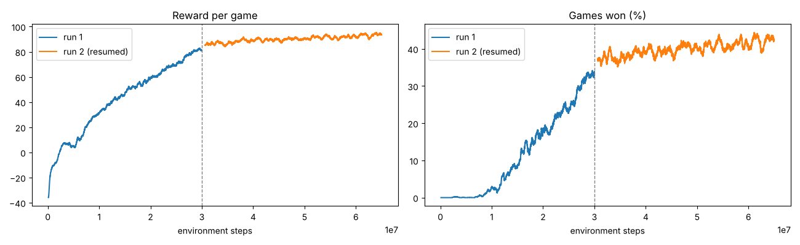

A third session (run 3, see [Late starts](#late-starts) below) resumed run 1 for 20 million steps
with games that start late. Run 3 was the `v2` agent until the rewards of `v2` were changed (see
[New rewards](#new-rewards-runs-4-and-5) below).

The rates during the training are for actions sampled from the policy. `pacman_play.py` plays the
best action while ghosts are present, which in `v2` means always, since eaten ghosts come back.
On the same 3000 games (`python pacman_play.py --game v2 -n 3000 --seed 1001 -w 4`):

| Agent | Won |
|---|---|
| run 1 (30M steps) | 50.1% |
| run 2 (run 1 + 35M steps) | 50.9% |
| run 3 (run 1 + 20M steps with late starts, `PPO_v2`) | **53.9%** |

Run 2 wins more of its training games but not more of the evaluation games: the extra training
made the sampled policy better without improving its best action.

On 3000 games, the standard error of a win rate is about 0.9 points, and that of the difference
between two agents about 1.3 points. A first comparison on 1000 games (`--seed 1`) gave 56.3% to
run 1 and 52.8% to run 2, and run 1 was chosen on these same games: a lucky set of games, made
luckier by the choice. Agents that are a few points apart must be compared on several thousand
games, and on games that were not used to choose between them.

#### Where the games are lost

95% or more of the lost games are lost to the "other" causes of `--show-losses`: Pacman is caught
in the middle of the game, not when his power runs out or at the start. The ghosts of `v2` chase
him all the time: each ghost chases on a move with the probability of its aggressiveness and moves
at random otherwise, so there is no lasting pause in the chase, unlike the "scatter" periods of the
arcade game, in which all the ghosts leave for their corners.

The end of the game is where run 1 is weakest. Half of its lost games are lost with 22 cookies left
or fewer (out of 162). Per move, Pacman is caught 5 to 6 times more often at the end of the game
than at the start, and the last cookies are slow to eat: 9.1 moves per cookie for the last 10,
against 1.7 for the first 40. This is caution, not wandering: in the end game a ghost is within 3
moves of Pacman on 71% of the moves, and he runs away from it. When the ghosts are far, he heads
for a cookie about as often as at the start of the game.

Early in the game, Pacman lets the two most aggressive ghosts come close and then escapes to a part
of the maze where there are none, eating cookies on the way. In the end game the empty part of the
maze has usually been cleared already. Where the last 10 cookies are, and where Pacman is caught
(1000 games of run 1):

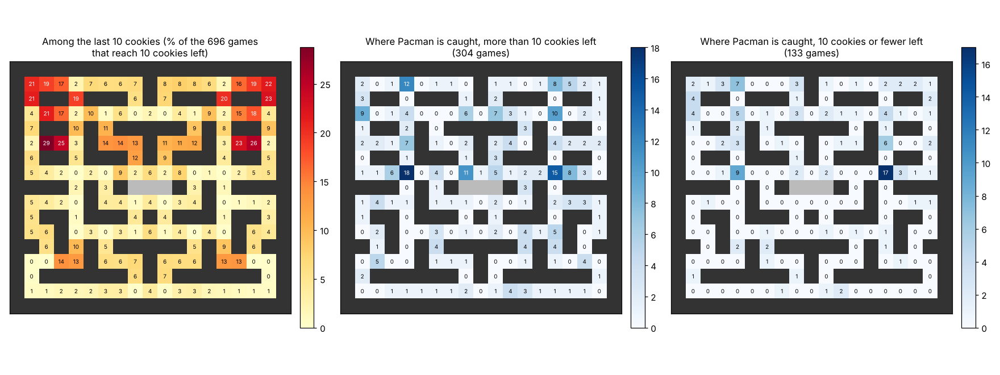

The ghosts leave the house by the door above it, into the corridor just above the house. Pacman
clears the bottom of the maze first and leaves the top corners for the end, and to reach them he
has to cross the junctions of that corridor, where most of the games are lost.

The look-ahead search does not help: on 60 games, `--search 20` wins 53.3% of them and the agent
alone 54.2% (the search changes 2.9% of the moves). Expert iteration, which needs the search to find
better moves than the agent, is therefore not a way forward on `v2` as it was on `v1` with this
short search; a Monte Carlo tree search does find better moves (see
[Monte Carlo tree search](#monte-carlo-tree-search) below).

#### Late starts

To practise the end of the game more often, `run_episodes` of the A2C agent can start some games
late (`late_start_prob`, `LATE_START_PROB` in the notebooks). The games started from the beginning
are copied (`env.clone()`) when they reach a number of cookies left drawn between 10 and 40, and a
new game starts from one of the last 2000 copies with probability `late_start_prob` instead of from
the beginning. The copies come from the agent's own games, so the cookies left are where his own
play leaves them, and they follow the agent as it learns. Nothing in the rewards or in the rules
changes: this is the "exploring starts" idea of Monte Carlo control.

Run 3 resumed run 1 for 20 million steps with `LATE_START_PROB = 0.25` at the learning rate 2.5e-5.
The games that start late are won more and more often (from 58% to 64%), and the agent wins 53.9%
of the 3000 evaluation games, 3.8 points more than run 1 and 3.0 more than run 2, which trained
longer without late starts:

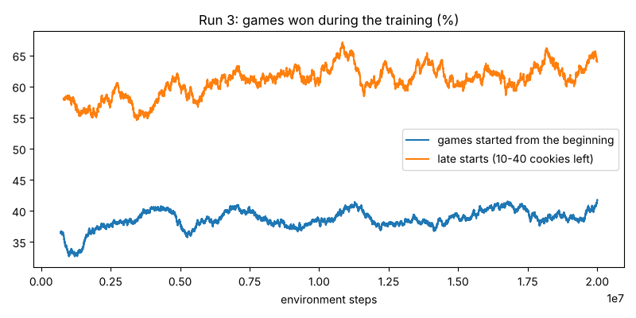

#### New rewards (runs 4 and 5)

Watching run 3 play showed Pacman hunting the ghosts whenever he had power. The rewards of `v1`
asked for it: a cookie eaten with power was worth nothing while a ghost was left (in `v2` there is
always one), and a power cookie was worth more with a ghost close. Since then, in `v2`, the cookies
eaten with power keep their reward and a power cookie is worth a fixed 1.3 (see the table of
[Game v2](#game-v2)).

Run 4 was trained from scratch with these rewards and the late starts (`LATE_START_PROB = 0.25`),
for 60 million steps on a Colab T4 (about 870 steps per second, 19 hours), the learning rate
decreasing from 2.5e-4 to 2.5e-5 and the curriculum over the first 20% of the training. It wins its
first games after 2 million steps (run 1: 8 million), and half of its training games at the end:

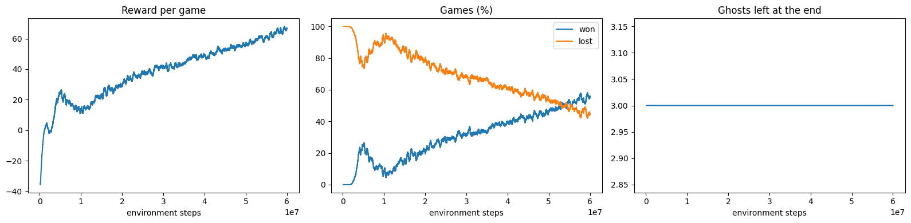

Run 5 resumed run 4 at 2.5e-5 with the late starts. Its training games were won no more often
(from 52% to about 54%), but the agent kept improving: on the same 3000 games
(`--seed 4001`), run 3 wins 54.5%, run 4 56.8% at 50 million steps and 60.0% at 60 million, and
run 5 60.5%, 63.2% and 64.5% after 5, 10 and 15 million more steps. As with run 2, the rates of
the training games, played with sampled actions, are not a guide to the agent's best action.

The checkpoint of run 5 at 15 million steps was chosen on these games, so it was evaluated again on
3000 others (`--seed 7001`): it wins 64.8% of them, run 4 59.9%. It was the `v2` agent until the
expert iteration below.

#### Monte Carlo tree search

Is 64% good? A strong player says what the game allows. `pacman_mcts.py` is a Monte Carlo tree
search (MCTS) used by `pacman_play.py --mcts N` when a ghost is close:

    python pacman_play.py --game v2 -n 100 --mcts 100 -w 4

Unlike Hex (see the MCTS of [Hex_game_AI](https://github.com/CL-BZH/Hex_game_AI)), Pacman is the only player: the ghosts do not choose their moves to beat him, they
follow the random rules of the game. They are chance, as the dice of backgammon, so the value of a
move is an average over their behaviours, not a minimum. The search is "open-loop": its tree holds
only Pacman's move sequences, and each simulation replays them on a copy of the game
(`env.clone()`) where the ghosts move by the game's own code with random numbers of their own. Each
simulation descends the tree with the PUCT rule of AlphaZero (the agent's policy as prior); at a
new node the agent plays greedily for 10 moves and its value estimates the rest of the game. The
most visited move is played. The search saves and restores the random state of the real game, so
the games played with and without search are the same games.

The value of a node must include the reward of the move that leads to it: a move onto a ghost ends
the game, and without its -35 the search preferred walking into a ghost in tight spots (it won 3 of
20 games that the agent alone won 14 times).

The simulations can run in waves (`batch` in `pacman_mcts.py`): a "virtual loss" makes the
simulations of a wave take different branches, and their network evaluations are made in one batch.
Waves of 16 are about twice as fast, but a simulation of a wave does not see the results of the
others, and the virtual loss pushes it away from the best move, which near a ghost is often the only
good one. On 70 paired games, waves of 16 won 52 and one simulation at a time 57 (not significant,
16 against 11 disagreements), and the waves overrode the agent half as often: the default is one
simulation at a time. A cache of the ghosts' shortest paths (`ghost_agents.py`, which changes no
game) makes every search faster.

On the same 100 games (`--seed 4001`), with 100 simulations per searched move:

| Same 100 games | Won |
|---|---|
| run 5 (15M) alone | 68% |
| run 5 (15M) with MCTS | **82%** |

The search wins 26 games that the agent loses and loses 12 that the agent wins: if the two players
were equally strong, a split at least this lopsided would have a probability of about 0.017 (sign
test). The search moves the ghosts with the game's own code: it knows their rules exactly (each
ghost's aggressiveness, the shortest-path chase), though not the random draws of the real game. A
fair player would have to estimate these rules by watching the ghosts, as the `estimated` model of
the look-ahead search does (on `v1`, that model did as well as the exact one; on `v2` it does not,
see "A fair search" below). 82% is therefore what a modest search achieves knowing the ghosts'
rules, not what a fair player can reach.

#### Expert iteration with the MCTS

The search is too slow to play (about 8 minutes per game on one core), but it can teach.
`pacman_expert.py --teacher mcts` runs expert iteration as in AlphaZero: the agent plays its own
games, and at each move where a ghost is close the target of its policy is the search's visit
distribution over the moves (a one-hot target for the look-ahead search of `v1`):

    python pacman_expert.py --game v2 -c Trainings/A2C/PPO_v2/pacman_a2c_final.pth --teacher mcts \
        --mcts-sims 100 --iterations 5 --games 200 --keep 2 --epochs 3 --workers 4

In the notebooks: `AGENT = "expert"`, `RESUME_FROM` = the `v2` agent, and the `EXPERT_OPTIONS`
given in the comment of the configuration cell.

Four iterations of 200 games from run 5 (15M), with 100 simulations per search, took 7.5 hours on a
Colab T4 with 8 CPU cores (`High-RAM`; almost all the time is spent in the search). The search
overrode the agent 9.6 times per game at the first iteration, then 4.9, 4.7 and 4.3: the network
learnt about half of the search's corrections at once, then little more. The games won by the
agent alone, measured on the 200 games of each iteration, look like a steady rise:

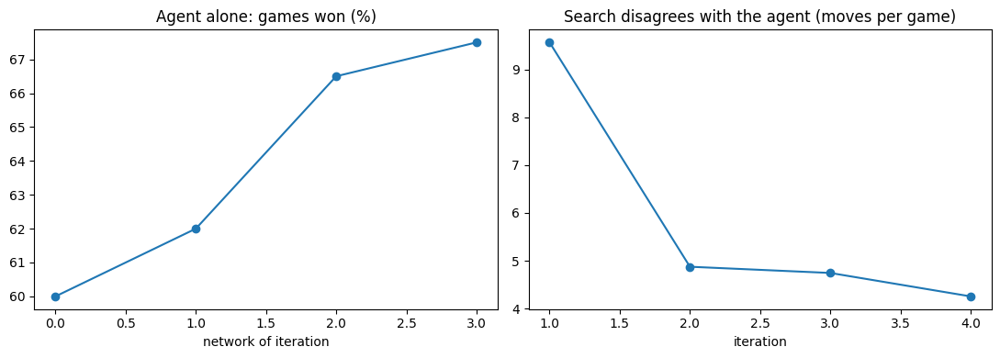

but each point has a standard error of about 3.4 points. On the same 3000 new games
(`--seed 10001`, compared game by game):

| Same 3000 games | Won |
|---|---|
| run 5 (15M), the start of the expert iteration | 65.9% |
| after 4 iterations of expert iteration (`PPO_v2`) | 67.3% |

The expert agent wins 664 games that the start agent loses, and loses 624 that it wins: if the two
were equally strong, a split at least as uneven would happen about 28% of the time (sign test). The
gain, if any, is small. The expert agent is the one saved in `Trainings/A2C/PPO_v2` (the default of
`pacman_play.py --game v2`), since it is at least as good.

On `v1`, expert iteration recovered about 60% of the search's gain (97.1% to 97.7%, the search
reaching 98.1%); on `v2` it recovers about a tenth of it (65.9% to 67.3%, the search reaching about
82%). The network reproduces only about 65% of the search's corrections on its own training data
(76% on `v1`): what the search adds on `v2` is computation, not only knowledge. Before a dangerous
move it simulates the ghosts' random behaviour dozens of times and finds an escape for this
particular configuration; a network has to turn that into a reflex, from targets that are
themselves noisy (with 100 simulations, the search does not always choose the same move in the
same position). A stronger and more consistent teacher, more data, or a larger network could
transfer more; so could keeping the PPO training with a penalty for straying from the search's
choices (see the TODO list).

A test separates noisy targets from a network too small. On 300 dangerous positions, the search was
run twice (different random numbers) with 100 and with 400 simulations. Two searches chose the same
move on 97% and 93% of the positions, but mostly because both followed the network (the network's
move on 92% to 96% of them). Where the search overrode the network, a second search made the same
override only about half the time (6 of 12 with 100 simulations, 9 of 24 with 400): the corrections
that matter are close calls decided by the random simulations, and a network cannot learn a coin
flip, however large it is.

#### Training longer (run 6)

Run 6 repeats run 4 (new rewards, late starts, from scratch) over 100 million steps instead of 60,
the learning rate and the curriculum stretched accordingly. It took 20 hours on a Colab T4 (1400
steps per second instead of 870, thanks to the cache of the ghosts' shortest paths). Its training
curve rose steadily to the end:

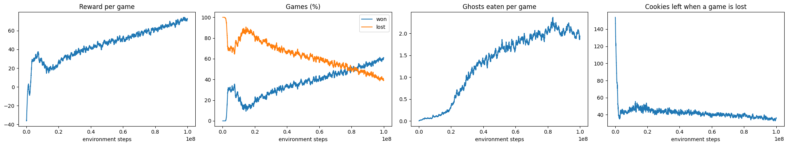

but its checkpoints, on the same 3000 new games (`--seed 13001`), level off:

| Steps | Evaluation (best action) | Training (sampled actions) | Gap |
|---|---|---|---|
| 60M | 52.6% | 35.2% | 17.4 |
| 80M | 60.7% | 43.8% | 16.9 |
| 90M | 63.4% | 49.9% | 13.5 |
| 100M | 64.1% | 55.0% | 9.1 |

(Training: games started from the beginning, around the checkpoint; the plot also includes the late
starts, which are won more often.) The expert agent wins 66.4% of these games: run 6 is not better
(p = 0.06), and the expert agent stays in `Trainings/A2C/PPO_v2`.

The ghosts are random in the training games and in the evaluation; Pacman is random only in the
training, where PPO samples its action to explore. A fatal non-best action with probability 2% at
each of 20 dangerous moments of a game loses a third of the games. As the policy becomes more
confident (its entropy fell from 0.50 to 0.40), these mistakes become rarer and the training rate
rises towards the evaluation, even when the best action no longer improves: over the last 10
million steps, the evaluation gained less than 1 point and the training rate 5.

Three routes now end at the same level: fine-tuning (run 5, 65.9%), expert iteration (66-67%) and a
longer schedule (run 6, 64.1%). When more training, more data and a teacher's knowledge all stop at
the same place, the limit is likely the agent itself: a reflex that maps the last two images to a
move, where escaping three randomly moving ghosts sometimes needs looking a few moves ahead (the same
network wins 82% when it can). The next directions were planning at play time, fairly (a search
that estimates the ghosts' behaviour from their moves, measured below), or a network with more to
work with (memory, more images, a larger field of view).

#### A fair search

`pacman_mcts.py` has a second ghost model, `--mcts-ghosts estimated`: the simulated ghosts follow the
generic model of the look-ahead search (towards Pacman along a shortest path with probability
`p_chase`, away from him with probability `p_flee` when he has power, at random otherwise), the two
probabilities being estimated for each ghost from its moves since the start of the game. Every game
starts from no information: nothing is carried from one game to the next. The model has a generic
form, simpler than the real ghosts' (see below), with two parameters per ghost.

`Tools/mcts_eval.py` plays the three players on the same games (in the notebook
`Tools/mcts_eval_kaggle.ipynb`, on Kaggle's CPU, which does not use the GPU quota). With run 6
(100M steps, trained by PPO only: the expert agent learnt from the search with the exact model), 100
simulations one at a time, on the same 60 games (`--seed 4001`; the 12 hours of a Kaggle session at
about 18 minutes per game):

| Same 60 games | Won |
|---|---|
| run 6 alone (64.1% on 3000 games: these 60 are easier) | 71.7% |
| run 6 with MCTS, estimated ghosts | 66.7% |
| run 6 with MCTS, exact ghosts | 80.0% |

The fair search wins 9 games that the agent loses and loses 12 that the agent wins: it does not
help. An earlier run (run 5, waves of 16, 100 games) gave the same answer, 17 against 14 (71%
against 68%). The exact search wins 16 games that the fair search loses, and loses 8.

So almost all of what the search added came from knowing the ghosts' rules, not from looking ahead.
Within one game, the estimates rest on few observed moves, and the generic model's chase differs from
the real ghosts' in the close encounters that decide a game; a search that trusts a wrong model
overrides good moves of the network.

How wrong is the model? `Tools/ghost_fidelity.py` lets the agent play 100 games and, at each move,
simulates the move 100 times with the game's code and 100 times with the estimated model, giving two
distributions of each ghost's next cell; the real move is then compared with both. For the ghosts
within 6 cells of Pacman, the mean log-likelihood of the real move is -0.750 with the true rules,
-0.776 with the estimated model and -1.211 for a uniform choice: per move, the estimated model
captures about 94% of what can be predicted. Ghosts 0 and 1, which chase along shortest paths as the
model assumes, are well predicted (total-variation distance 0.07 and 0.09 between the two
distributions); ghost 2, which chases by straight-line distance and can be blocked by walls, is not
(distance 0.17, and the model is barely better than a uniform choice for it). Small errors per move
were enough to cancel the search's gain: they compound over the simulated moves of three ghosts, and
the search relies on them exactly where the network's reflex was right.

So the fair search does not show that a fair planner cannot do better. A model of the ghosts learnt
from many games (a "world model": a network predicting each ghost's next cell, trained by supervised
learning on recorded games) would not be limited to a fixed form; it would still be fair, Pacman
learning from experience. But it would have to be very accurate to help.

#### Four frames (run 7)

With two frames, the network sees only the last move of each ghost. Run 7 repeats run 4 (60 million
steps, the same schedule, late starts) with four frames (`N_FRAMES = 4`, 12 hours on a Kaggle T4),
so that it can see a ghost's last three moves. Its training curve stayed 2 to 3 points below run 4's
all along (50.5% against 53.2% over the last 6 million steps), but on the same 3000 new games
(`--seed 16001`, `Tools/mcts_eval.py --configs agent`):

| Same 3000 games | Won |
|---|---|
| run 4 (2 frames, 60M steps) | 60.0% |
| run 7 (4 frames, 60M steps) | 61.3% |
| run 6 (2 frames, 100M steps) | 64.9% |

Run 7 wins 723 games that run 4 loses and loses 686 that it wins (p = 0.34): no significant gain.
Run 6 beats both (p = 0.003 against run 7). Seeing more of the ghosts' past did not help; training
longer did. Once more, the training curve was not the evaluation: it was lower for the agent that
plays as well or slightly better.

#### Death starts (run 8)

Late starts practise the end of the game; death starts practise the situations in which Pacman was
caught. When Pacman loses, a copy of his game taken 5 to 20 moves before (drawn at random) is kept
(at most 2000 copies, each used at most 4 times), and a new game starts from one of these copies
with probability `death_start_prob`; the ghosts draw new random moves each time, so Pacman meets the
same trap with different outcomes. It is a form of prioritised replay of the starting states, as
Prioritized Level Replay replays the levels where the agent does worst. Copying a game costs 7
microseconds, so the last 20 positions of every game are kept.

Run 8 repeats run 6 (100 million steps, 21 hours on Kaggle) with `DEATH_START_PROB = 0.2` and
`LATE_START_PROB = 0.25`: 55% of the games start from the beginning. The death-start games were won
29% of the time at first and 66% at the end, and the games started from the beginning were won 1 to
2 points more often than in run 6 all along the training. But on the same 3000 new games
(`--seed 16001`):

| Same 3000 games | Won |
|---|---|
| run 6 | 64.9% |
| run 8 (death starts) | 64.4% |

Run 8 wins 665 games that run 6 loses and loses 680 that it wins (p = 0.70): no gain. Pacman learnt
to escape his traps more often in training, without playing better from the start of a game.

#### What game v2 taught

The work on `v2` went through several wrong turns; the methods that got it out of them are worth
more than the numbers. The course (chapter 16, "Game v2: an RL project from start to finish")
tells the story in detail.

1. **Evaluate on many games, and on games that were not used to decide.** With 1000 games the
   standard error of a win rate is 1.6 points (2.2 for a difference); with 3000, 0.9 (1.3). Run 1
   was chosen over run 2 on 1000 games where it won 56.3%; on 3000 new games it won 50.1%. Each
   comparison now uses fresh games, and the best of several agents is confirmed on others.
2. **Compare agents on the same games, game by game.** Only the games where they disagree carry
   information (sign test): this is how the MCTS's 82% against 68% on 100 games is significant,
   and how expert iteration's +1.3 points on 3000 games is not.
3. **The training curve is not the agent.** It shows the games played with sampled actions. Run 2
   rose in training and not in evaluation; run 5 stayed flat in training while its best action kept
   improving (60.0% to 64.5%); at the end of run 6, a falling entropy alone kept lifting the curve.
4. **Look at how the agent loses before changing anything.** Counting the losses by stage of the
   game, then by distance to the ghosts, then drawing where the last cookies are, turned "the agent
   is weak" into "the agent leaves the top corners for the end and is caught at their entrances",
   which suggested the late starts.
5. **Watch the agent play, and read the rewards it is given.** Pacman hunting ghosts with his power
   was not a mistake of the agent but what the rewards of `v1` asked for in a game where the ghosts
   come back. Fixing them was worth more than any amount of training (run 4).
6. **Prefer changes that do not encode the answer.** The late starts (exploring starts: practise
   the states where the agent's own games are lost) were preferred to a reward for the cookies of
   the top corners, which would have worked on this maze only.
7. **Measure the ceiling before investing.** A slow but strong player (the MCTS) showed that the
   agent, not the game, was the bottleneck, and gave a target (82%). Say what the reference player
   knows: this one knew the ghosts' rules. With the rules estimated by watching the ghosts, the same
   search did no better than the agent alone: the gain was the knowledge, not the search.
8. **Check a search against the agent alone before trusting it.** The first MCTS lost to the agent
   (3 of 20 games against 14): the value of a move did not include its own reward, so walking into a
   ghost looked best.
9. **Recognise a plateau.** When several independent routes (more training, a teacher, a longer
   schedule) stop at the same level, look at the agent's design rather than at more training.
10. **Check a faster version against the slow one.** The waves made the search twice as fast, and
    were not compared with one simulation at a time on enough games before being used; when a
    control with the same code disagreed with an earlier result, it was the code that had changed,
    not the conclusion that had to be trusted. Decide on the complete set of games: a difference
    that looked clear on 50 games shrank on the next 20.
11. **Fix a stopping rule before the experiment, and check its reasoning.** Before measuring the
    fair search, it was agreed that near 70% (the agent's level) a learned world model would not be
    worth building, on the argument that the estimated model, knowing the form of the ghosts'
    behaviour, was an optimistic bound. The argument was wrong: the form was not the ghosts' own,
    which a measurement of the model (rather than of the search) showed.

## Some explanations about the software

### The files

`pacman_maps.py` is where to find the class ```PacmanMap``` use to create boards from
array of '0' and '1's.

Boards are defined as an array of '0' and '1'.

Below is and example.
```bash
pacman_map3 = PacmanMap([[1,1,1,1,1,1,1,1,1,1,1,1,1,1,1],
                         [1,0,0,0,0,0,0,1,0,0,0,0,0,0,1],
                         [1,0,1,0,1,1,0,1,0,1,1,0,1,0,1],
                         [1,0,1,0,0,0,0,0,0,0,0,0,1,0,1],
                         [1,0,1,1,0,1,1,1,1,1,0,1,1,0,1],
                         [1,0,0,0,0,0,0,0,0,0,0,0,0,0,1],
                         [1,1,1,0,1,1,0,1,0,1,1,0,1,1,1],
                         [1,0,0,0,1,0,0,0,0,0,1,0,0,0,1],
                         [1,0,1,0,1,0,1,1,1,0,1,0,1,0,1],
                         [1,0,0,0,0,0,1,1,1,0,0,0,0,0,1],
                         [1,1,1,1,1,1,1,1,1,1,1,1,1,1,1]])
```
Gives the board:

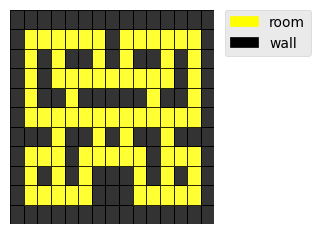

To see a board, use `pacman_show_map.py`. It also prints the size of the maze, its number of free
cells and dead ends, and whether it is left-right symmetric:
```bash
python pacman_show_map.py                     # board of game v2 at the start of a game
python pacman_show_map.py -g v1 --seed 3      # game v1; the seed makes the random start reproducible
python pacman_show_map.py --map pacman_map2   # any maze of pacman_maps.py, with the rules of v2
python pacman_show_map.py --empty             # the maze alone, without the pieces
python pacman_show_map.py -o board_v2.png     # save the image instead of opening a window
```

`algorthms.py` contains the algorithms for the agent.
Currently, two algorithms are defined, DQN and A2C.

`ghost_agent.py` contains the class `PacmanGhost` that defines the ghosts and their behaviors.

`memories.py` contains the n-step replay memory used by DQN.

`neural_net.py` is for the definition of the convolutional neural networks used in DQN (`DuelingCNN`)
and A2C (`ActorCriticCNN`), and for the selection of the device (GPU or CPU).

`pacman_agents.py` is where to find the classes for the DQN and A2C agents

`pacman_env.py` is dedicated for the definition of the Pacman environment.

`pacman_conf.py` just contain a dataclass used for the configuration of the game.

`pacman_search.py` contains the look-ahead search used by `pacman_play.py --search`.

`pacman_mcts.py` contains the Monte Carlo tree search used by `pacman_play.py --mcts`.

`pacman_expert.py` trains the A2C agent with the look-ahead search or the MCTS as teacher (expert
iteration).

And we already talked about `pacman_play.py` and `pacman_train.py`.

### The code

#### Agents (`pacman_agents.py`)

`PacmanAgent` is the parent of all derived agents, `DQN_PacmanAgent` and `A2C_PacmanAgent`.
It builds the states (stacks of the last `n_frames` images of each environment, see
`stacked_observation()`), chooses the start positions of new games (`reset_env()`), and
provides `reset_episode()` and `observe()` to play games (see `pacman_play.py`).

The function `run_episodes()` is used for the training. Both agents step all the environments
in lockstep: the network chooses the actions for all the environments in a single batched forward
pass, every environment performs one move, and finished games are restarted immediately.
- `DQN_PacmanAgent` stores each transition in the replay memory and updates the network after each move.
- `A2C_PacmanAgent` collects `n_steps` moves in every environment, computes the advantages, then updates the network.

#### Algorithms (`algorithms.py`)

##### About the A2C / PPO implementation

`A2C.compute_gae()` computes the advantages with GAE:
```math
\delta_t = r_t + \gamma\,(1-d_t)\,V(s_{t+1}) - V(s_t), \qquad
\hat{A}_t = \delta_t + \gamma\lambda\,(1-d_t)\,\hat{A}_{t+1}
```
where $`d_t = 1`$ if the game ended after the action $`a_t`$. The value targets are $`\hat{A}_t + V(s_t)`$.
For aborted (too long) games, the value of the reached state is added to the last reward, since the game did not really end.

`A2C.update()` minimises, on each mini-batch,
```math
\mathcal{L} = -\frac{1}{B}\sum_t \min\big(\rho_t \hat{A}_t,\ \mathrm{clip}(\rho_t, 1-\epsilon, 1+\epsilon)\,\hat{A}_t\big)
+ c_v \frac{1}{2B}\sum_t \big(\hat{A}_t + V_{old}(s_t) - V(s_t)\big)^2 - c_e\, \mathcal{H}(\pi)
```
with $`\rho_t = \pi(a_t|s_t) / \pi_{old}(a_t|s_t)`$ and the advantages normalised over the mini-batch.

##### About the DQN implementation

`DQN.learn()` uses Double DQN n-step targets
```math
y = \sum_{k=0}^{m-1}\gamma^k r_{t+k} + \gamma^m (1-d)\, Q_{target}\big(s_{t+m}, \arg\max_a Q(s_{t+m}, a)\big)
```
with the Huber loss, and updates the target network with $`\theta' \leftarrow \tau\theta + (1-\tau)\theta'`$.

## TODO
<ul>
<li> Code cleaning </li>
<li> The MCTS as expert inside PPO (as in RLHF): train with PPO on the game's rewards, with a KL
penalty that keeps the policy close to the MCTS's visit distributions, instead of pure imitation;
compare with expert iteration (also for the course) </li>
<li> A KL-adaptive learning rate for PPO (raise it when the KL between successive policies is well
below a target such as 0.01, lower it when well above) instead of the fixed linear decay; compare
with the 100M-step run (see the course, chapter 9, "Choosing the learning rate") </li>
</ul>


