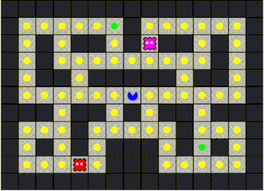
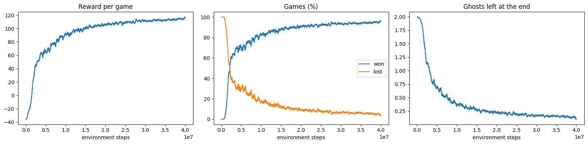
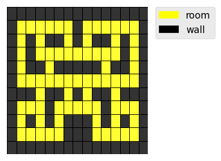

# My own Pacman for Reinforcement Learning
This depository contains the code of a Pacman game I wrote from scratch for testing reinforcement learning algorithms.

Currently, 2 algorithms are implemented, DQN and A2C (trained with PPO updates by default).

## To run games

To let Pacman play games run the command below in a terminal.
```bash
python pacman_play.py
```

By default, the trained A2C agent saved in `./Trainings/A2C/PPO_1/pacman_a2c_final.pth` plays one game.
The options are listed with `python pacman_play.py --help`. For example:
```bash
python pacman_play.py -n 1000                         # statistics over 1000 games
python pacman_play.py -c Tmp/pacman_a2c_final.pth     # another checkpoint (e.g. a new training)
python pacman_play.py -a dqn                          # the DQN agent (./Trainings/DQN/pacman_dqn_final.pth)
python pacman_play.py --speed 0.3 --wait 10           # slower display
python pacman_play.py -n 200 --show-losses            # replay up to 5 of the lost games with display
```

The game configuration (board, ghosts, rewards) is the one defined in `pacman_training.py`,
so that the agent plays the game it was trained on.

With one game (`-n 1`, the default), the game is displayed as in the example below.



(***In the "Media" directory you will find the same with music...***)

With more games, they are played without display and statistics are provided at the end.

This is the output obtained with `-n 1000` with the current A2C agent (trained with PPO, see below).
```bash
Pacman won 96.60% of the games
Number of game aborted:
	with 0 ghost: 0
	with 1 ghost: 0
	with 2 ghost: 0
Percentage of games with
	0 ghost: 93.6
	1 ghost: 3.3
	2 ghost: 3.1
Average number of ghost per game: 0.095
Percentage of power cookies eaten per game:
	0 power cookies: 2.9
	1 power cookies: 0.3
	2 power cookies: 96.8
Average number of power cookies eaten per game: 1.939
```

For comparison, the original A2C agent (stride-2 network, RGB input with 1 frame, n-step returns,
no PPO) obtained:

| | Original A2C | Current A2C (PPO) |
|---|---|---|
| Games won | 79.4% | 96.6% |
| Games ending with 0 ghost left | 51.4% | 93.6% |
| Games with both power cookies eaten | 83.4% | 96.8% |
| Average number of ghosts left | 0.69 | 0.095 |

Each game is played with its own random seed (printed at the end), so a set of games can be played
again identically with `--seed`. With `--show-losses N`, the games are first played without display,
then up to `N` of the lost games are replayed with display, to see how Pacman loses.

With several games, the lost games are also classified by cause:
- `off-by-one`: Pacman moved onto a ghost on the move where his power ran out. The power credit is
  decreased at the beginning of Pacman's move, before the collision test, so with 1 move of power
  left, moving onto a ghost kills Pacman.
- `power-ended`: Pacman was caught at most 3 moves after his power ran out (other cases).
- `bad-start`: Pacman was caught in the first 5 moves of the game, without having had any power.
- `other`: all the other lost games.

`--cause` selects the games to replay, e.g. `python pacman_play.py -n 1000 --show-losses --cause off-by-one`.

### Look-ahead search

With `--search N`, a look-ahead search (`pacman_search.py`) checks the agent's moves when a ghost is
close (at most `--radius` cells, 5 by default). Each possible move is simulated `N` times on copies of
the game: the move is played, then the trained agent plays alone for at most `--horizon` moves (15 by
default). In the default `safety` mode, the agent's move is kept unless Pacman dies in clearly more
simulations with it (15% more) than with another move; the search then plays the move with the
fewest deaths. It corrects the agent when it walks into a trap, which the network alone does not
always see.

```bash
python pacman_play.py -n 1000 --search 20 --workers 8    # 8 games played in parallel
```

The search is slow (about 100 simulated games per searched move), so `--workers` plays several games
in parallel.

`--ghost-model` sets how the ghosts move in the simulations:
- `chase` (default): worst case, the ghosts always move towards Pacman (along a shortest path) when he
  has no power, and randomly when he has power.
- `estimated`: when Pacman has no power, a ghost moves towards him with probability `p_chase`, and
  randomly otherwise; when he has power, it moves away from him with probability `p_flee`, and
  randomly otherwise. Both probabilities are estimated for each ghost from its observed moves since
  the beginning of the game.
- `exact`: the game's own code for the ghosts, i.e. a perfect knowledge of their behaviour.

`chase` and `estimated` do not use the game's code for the ghosts: the search only uses what an agent
can observe, while `exact` would give it knowledge that the agent does not have. (Over many games, the
estimates are about 0.73 and 0.64 for `p_chase`, close to the configured aggressiveness levels 0.74 and
0.64, and about 0.08 for `p_flee`: edible ghosts move almost randomly.)

With 20 simulations per move, the search was evaluated on 1000 games (all the lost games, and a sample
of about 200 of the won games, replayed with search):

| Ghost model | Estimated win rate |
|---|---|
| no search | 96.1% |
| `exact` | 97.1% (± 0.5) |
| `chase` | 97.5% (± 0.5) |
| `estimated` | 97.7% (± 0.3) |

The gain (about 1 to 1.5 points) does not come from knowing the ghosts' code. Most of the lost games
that are not saved are bad starts. The `value` mode (`--search-mode value`, play the move with the
best simulated score) did not improve the win rate: with 20 simulations, the averages are too noisy
and it changes many good moves by chance.

## To train the model

To train the model run the command below in a terminal.
```bash
python pacman_training.py
```

In the main function in file `pacman_training.py` you can select the agent you want to train.

```Python
if __name__ == "__main__":
    
    #dqn_training()
    a2c_training()
```

You can also configure the game, the hyperparameters (e.g `initial_learning_rate`), etc.

Example:
```Python
pacman_conf = PacmanConf(playground = pacman_map3,
                         ghost_aggressiveness_levels = [0.74, 0.64],
                         edible_ghosts_behavior = [EdibleGhostBehaviors.FLEE_FAST,EdibleGhostBehaviors.FLEE_FAST],
                         n_ghosts = 2,
                         n_power_cookies = 2,
                         max_power_credit = 12,
                         eat_cookie_reward = 0.8,
                         eat_power_cookie_reward = 1.3,
                         eat_ghost_reward = 20,
                         living_cost = -0.15,
                         lose_reward = -35,
                         win_reward = 30,
                         penalty_per_ghost = -5)
```

### GPU

Both agents automatically run on a CUDA GPU (or Apple Silicon `mps`) when one is available,
and fall back to the CPU otherwise. A device can be forced with the `device` argument
(e.g. `DQN_PacmanAgent(envs, device="cpu")`).

### A2C / PPO

The actor-critic agent has the following features:
- **Input**: instead of an RGB image, the state is made of feature planes
  (`PacmanEnvironment.feature_image`): walls, cookies, power cookies, Pacman, one plane per ghost
  (the ghosts have different aggressiveness, so the agent can tell them apart) and Pacman's remaining power.
  Walls can no longer be confused with empty cells.
- **2 stacked frames** (one stack per environment), so that the direction in which the ghosts move is visible.
- **Network**: full-resolution convolutions shared by a policy head and a value head. Since the board
  is left-right symmetric, the network is made exactly equivariant to this symmetry: the outputs for a
  state and for its mirror image (with East and West swapped) are averaged. The agent cannot learn a
  different behaviour on the two halves of the board, which is equivalent to doubling the training data.
- **Advantages**: GAE($\lambda = 0.95$), normalised per mini-batch.
- **Updates**: PPO clipped objective, 4 epochs of 4 mini-batches on each rollout of
  16 environments × 128 steps. With `ppo_epochs=1` and `n_minibatches=1` the update is exactly A2C (with GAE).
- **Curriculum**: the ghosts' aggressiveness starts at 30% of its configured value and reaches 100%
  after 20% of the training.

Statistics for every game are saved in `./Tmp/pacman_a2c_training_log.csv`.

Training curves of the agent saved in `./Trainings/A2C/PPO_1` (40 million steps on a Kaggle GPU;
averages over the last 2000 games):


### DQN

The DQN agent combines the improvements that matter most in practice:
- **Double DQN** targets (the online network picks the next action, the target network evaluates it),
- a **dueling** network $Q(s,a) = V(s) + A(s,a) - \overline{A}(s,\cdot)$ whose convolutions keep the full board resolution,
- **3-step returns**, which propagate the sparse rewards (eating a ghost, winning) much faster,
- a slowly moving (Polyak, $\tau = 0.005$) **target network**,
- **reward scaling** (×0.1) so that the TD errors stay in the range where the Huber loss works well,
- 2 stacked frames, so that the network can see in which direction the ghosts move.

Training is driven by environment steps: all the environments move in lockstep, the actions for
all of them come from a single batched forward pass, finished games restart immediately, and
the network is updated after every move (`train_freq=1`, i.e. each transition is replayed about
8 times with 16 environments and batches of 128). On a CPU, `train_freq=2` halves the cost.
Statistics (rewards, win/loss rates, ghosts left, ...) for every game are saved in
`./Tmp/pacman_dqn_training_log.csv`.

To train it, uncomment `dqn_training()` in `pacman_training.py`.

Without a local GPU, the notebooks `./Tools/train_kaggle.ipynb` and `./Tools/train_colab.ipynb`
train the A2C/PPO or the DQN agent on a free Kaggle or Google Colab GPU, save checkpoints
regularly, and can resume a previous training.

With the ipython notebook `./Tools/plottings.ipynb` it is possible to visualize 
the progress of the training. Below is an example of the plotting of the training
evolution.


### Expert iteration: the search as teacher

`pacman_expert.py` trains the A2C agent with the look-ahead search as teacher (expert iteration,
in its DAgger form). Each iteration:
1. The current agent plays games alone (in parallel processes). At each move where a ghost is
   close, the search (safety mode) gives the move it would play: as the games are played by the
   agent, the search labels exactly the situations the agent gets into, including its mistakes.
2. The policy learns to play the search's move where a ghost is close (with a larger weight where
   the search disagrees with the agent), and its own move elsewhere, so that the rest of its play
   does not change. The value head learns the discounted returns observed in the games.

The games of each iteration are played without search, so their results measure the agent alone.
It starts from the agent in `Trainings/A2C/PPO_1`:
```bash
python pacman_expert.py --iterations 10 --games 2000 --workers 4    # see --help for the options
python pacman_play.py -c Tmp/expert/pacman_expert_final.pth -n 1000
```
In the notebooks, set `AGENT = "expert"`.

A first small test on CPU (3 iterations of 750 games) did not change the win rate of the agent alone
(96.0% before, 95.5% to 96.1% after, on 2000 games): the search disagrees with the agent only about
0.3 times per game, so an iteration gives a few hundred corrections. The network learns them (the
search disagrees less often after training: 0.33 then 0.24 times per game), but more games are needed
to see an effect on the win rate.

## Some explanations about the software

### The files

`pacman_maps.py` is where to find the class ```PacmanMap``` use to create boards from
array of '0' and '1's.

Boards are defined as an array of '0' and '1'.

Below is and example.
```bash
pacman_map3 = PacmanMap([[1,1,1,1,1,1,1,1,1,1,1,1,1,1,1],
                         [1,0,0,0,0,0,0,1,0,0,0,0,0,0,1],
                         [1,0,1,0,1,1,0,1,0,1,1,0,1,0,1],
                         [1,0,1,0,0,0,0,0,0,0,0,0,1,0,1],
                         [1,0,1,1,0,1,1,1,1,1,0,1,1,0,1],
                         [1,0,0,0,0,0,0,0,0,0,0,0,0,0,1],
                         [1,1,1,0,1,1,0,1,0,1,1,0,1,1,1],
                         [1,0,0,0,1,0,0,0,0,0,1,0,0,0,1],
                         [1,0,1,0,1,0,1,1,1,0,1,0,1,0,1],
                         [1,0,0,0,0,0,1,1,1,0,0,0,0,0,1],
                         [1,1,1,1,1,1,1,1,1,1,1,1,1,1,1]])
```
Gives the board:



`algorthms.py` contains the algorithms for the agent.
Currently, two algorithms are defined, DQN and A2C.

`ghost_agent.py` contains the class `PacmanGhost` that defines the ghosts and their behaviors.

`memories.py` contains the n-step replay memory used by DQN.

`neural_net.py` is for the definition of the convolutional neural networks used in DQN (`DuelingCNN`)
and A2C (`ActorCriticCNN`), and for the selection of the device (GPU or CPU).

`pacman_agents.py` is where to find the classes for the DQN and A2C agents

`pacman_env.py` is dedicated for the definition of the Pacman environment.

`pacman_conf.py` just contain a dataclass used for the configuration of the game.

`pacman_search.py` contains the look-ahead search used by `pacman_play.py --search`.

`pacman_expert.py` trains the A2C agent with the look-ahead search as teacher (expert iteration).

And we already talked about `pacman_play.py` and `pacman_train.py`.

### The code

#### Agents (`pacman_agents.py`)

`PacmanAgent` is the parent of all derived agents, `DQN_PacmanAgent` and `A2C_PacmanAgent`.
It builds the states (stacks of the last `n_frames` images of each environment, see
`stacked_observation()`), chooses the start positions of new games (`reset_env()`), and
provides `reset_episode()` and `observe()` to play games (see `pacman_play.py`).

The function `run_episodes()` is used for the training. Both agents step all the environments
in lockstep: the network chooses the actions for all the environments in a single batched forward
pass, every environment performs one move, and finished games are restarted immediately.
- `DQN_PacmanAgent` stores each transition in the replay memory and updates the network after each move.
- `A2C_PacmanAgent` collects `n_steps` moves in every environment, computes the advantages, then updates the network.

#### Algorithms (`algorithms.py`)

##### About the A2C / PPO implementation

`A2C.compute_gae()` computes the advantages with GAE:
```math
\delta_t = r_t + \gamma\,(1-d_t)\,V(s_{t+1}) - V(s_t), \qquad
\hat{A}_t = \delta_t + \gamma\lambda\,(1-d_t)\,\hat{A}_{t+1}
```
where $`d_t = 1`$ if the game ended after the action $`a_t`$. The value targets are $`\hat{A}_t + V(s_t)`$.
For aborted (too long) games, the value of the reached state is added to the last reward, since the game did not really end.

`A2C.update()` minimises, on each mini-batch,
```math
\mathcal{L} = -\frac{1}{B}\sum_t \min\big(\rho_t \hat{A}_t,\ \mathrm{clip}(\rho_t, 1-\epsilon, 1+\epsilon)\,\hat{A}_t\big)
+ c_v \frac{1}{2B}\sum_t \big(\hat{A}_t + V_{old}(s_t) - V(s_t)\big)^2 - c_e\, \mathcal{H}(\pi)
```
with $`\rho_t = \pi(a_t|s_t) / \pi_{old}(a_t|s_t)`$ and the advantages normalised over the mini-batch.

##### About the DQN implementation

`DQN.learn()` uses Double DQN n-step targets
```math
y = \sum_{k=0}^{m-1}\gamma^k r_{t+k} + \gamma^m (1-d)\, Q_{target}\big(s_{t+m}, \arg\max_a Q(s_{t+m}, a)\big)
```
with the Huber loss, and updates the target network with $`\theta' \leftarrow \tau\theta + (1-\tau)\theta'`$.

## TODO
<ul>
<li> Code cleaning </li>
</ul>


